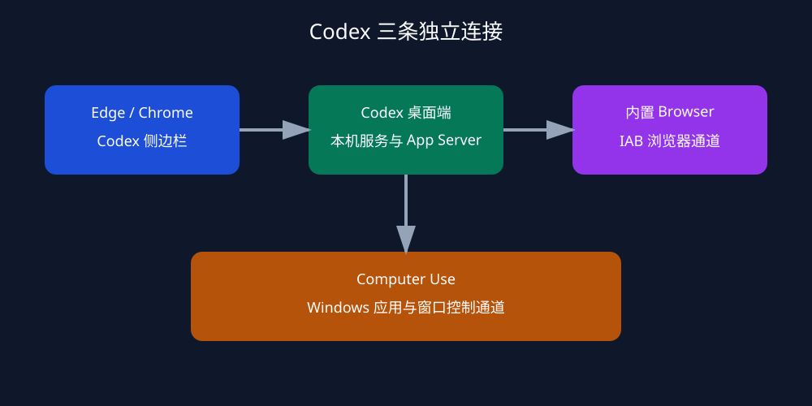

# Codex Windows Bridge Repair

用于 Windows Codex 的诊断与修复 skill，覆盖三条独立通道：

- Edge/Chrome 中的 Codex 侧边栏本机通信
- Codex 内置浏览器（Browser / IAB）
- Codex Computer Use

## 原理

Codex 更新后，AppX 版本号会变化。旧缓存、本机通信清单和运行时路径可能继续指向旧文件，于是出现 `Native transport disconnected`、`Codex Chrome native host v2 manifest is missing`、找不到 `browser-service.mjs` 等错误。



脚本从当前电脑实际安装的 Codex AppX 动态发现版本和官方组件，不写死用户目录或版本号。它逐文件计算 SHA-256；发现缓存缺失或版本不匹配时，从当前官方安装目录写入临时目录，校验通过后备份旧目录并替换。随后更新 Edge/Chrome Native Messaging 注册和 Codex v2 本机服务清单，并通过官方本机通信程序执行 hello/ensure 握手。


它不会删除整个插件缓存、修改 WindowsApps 安装目录，也不会打印令牌或本地服务 URL。报告会区分“已修复并验证”“仅校验文件”“需要浏览器确认”和“需要重启后再测”。

## 使用效果

已实际验证：

- Browser 和 Computer Use 缓存可恢复到当前官方版本
- Edge/Chrome 本机通信注册可恢复
- 本机通信程序和 Codex 本地服务可完成握手
- 内置浏览器可以打开页面并读取内容
- Computer Use 可以列出真实 Windows 应用
- Edge 连接可以读取打开的标签页

缓存文件存在只代表依赖完整。Edge 当前配置文件中的扩展是否启用、侧边栏是否能显示，仍需在浏览器里实际确认。

## 安装到 Codex

把整个仓库目录复制到：

```text
%CODEX_HOME%\skills\codex-windows-bridge-repair
```

未设置 `CODEX_HOME` 时通常使用：

```text
%USERPROFILE%\.codex\skills\codex-windows-bridge-repair
```

目录应包含：

```text
codex-windows-bridge-repair/
├─ SKILL.md
└─ scripts/
   ├─ Codex工具一键诊断修复.cmd
   ├─ repair.ps1
   └─ build.ps1
```

重启 Codex 或新开对话，然后输入：

```text
$codex-windows-bridge-repair
```

也可以输入：

```text
请使用 codex-windows-bridge-repair skill 扫描并修复 Codex 的 Edge 侧边栏、内置浏览器和 Computer Use 连接。
```

## 一键脚本

`scripts/Codex工具一键诊断修复.cmd` 是单文件脚本，可以单独复制到桌面或发送给其他 Windows 用户。

只扫描、不修改：

```powershell
.\Codex工具一键诊断修复.cmd --scan --no-pause
```

扫描并修复：

```powershell
.\Codex工具一键诊断修复.cmd --no-pause
```

运行前请打开 Codex 桌面应用。修改 `repair.ps1` 后，在同目录运行：

```powershell
powershell -ExecutionPolicy Bypass -File .\build.ps1
```

## 报告和备份

报告目录：

```text
%LOCALAPPDATA%\OpenAI\CodexBridgeRepair\runs\<时间>-<随机标识>\
```

其中可能包含 `report.json`、`backups\` 和 `registry-backup.txt`。报告不会记录令牌、本地服务 URL 或完整用户配置。

## 修复后验证

Edge：打开 `edge://extensions`，确认扩展已启用；打开侧边栏，必要时点击 Try again。

内置浏览器：

```text
请用内置浏览器打开 https://example.com/，读取页面标题和正文。
```

Computer Use：

```text
请使用 Computer Use 列出当前 Windows 应用。
```

只有能读取页面内容或返回真实应用列表，才算相应通道恢复。

## 常见原因与边界

常见原因包括版本号变化、缓存不完整、WindowsApps 受保护文件直接复制失败、Native Messaging 注册指向旧清单、v2 服务清单失效、Edge 扩展未启用，以及迁移工作目录后仍绑定旧路径。

本工具支持 Windows x64 和已识别的 Codex AppX v2 配置。遇到未知协议、未知清单格式、应用本体损坏、企业策略禁用扩展或扩展未安装时，会停止自动修改并给出建议。修复后仍失败时，先完全退出并重新打开 Codex，再分别测试三条通道。

## 文件

- [SKILL.md](SKILL.md)
- [一键脚本](scripts/Codex工具一键诊断修复.cmd)
- [PowerShell 修复逻辑](scripts/repair.ps1)
- [脚本构建器](scripts/build.ps1)
- [连接架构图](docs/architecture.svg)
- [修复流程图](docs/workflow.svg)
